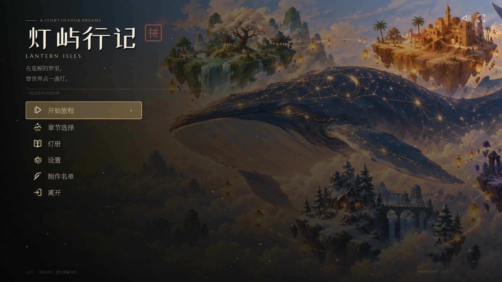

# 灯屿行记 · Lantern Isles

> 在星鲸的梦里，替世界点一盏灯。

一款用 **Godot 4.7.2** 制作的 2.5D 斜视角、透视相机、低多边形箱庭探索游戏。
世界是一头名叫「大肥鱼」的星鲸的梦；你是一只抱着纸灯的小灯灵「拾」，要在四段不同的梦（春庭、沙海、雪谷、星夜）里收集余烬、倾听回声、点亮心灯，最后把守灯人的名字还给她。



## 成品内容

- **4 个大型箱庭章节**，每章约 **160 × 160 m** 的高度场，包含台地、峡谷、山脊、瀑布、池塘、桥梁、隐藏洞窟/高台，不是一条直线走到黑。
- **四套完整色彩与光影**：苔庭·春眠 / 琥珀沙海·长夏 / 霜枝谷·静冬 / 星坠之穹·归夜；每章有独立天空、雾、太阳角度、光色调与粒子（樱花、沙尘、雪、萤火、星雨）。
- **胶囊主角**：奶油色胶囊 + 草帽 + 围巾 + 会呼吸的提灯；步行、奔跑、跳跃、落地、脚步音效与镜头跟随。
- **探索玩法**：20 枚余烬、8 段记忆、8 个可交谈的记忆回声、4 座心灯、4 条章节入场/收束叙事、可选秘密余烬。
- **完全定制的 UI**：主菜单、章节选择、暂停菜单、灯册、设置、制作名单、章节开篇/开灯过场、序章、结局。全部用 StyleBox、Control、手写 SVG 图标和 Draw 绘制，不使用 Godot 默认皮肤。
- **原创音乐与环境声**：6 首无缝循环音乐（标题/四章/结局）、4 段环境声、30 个音效（脚步、跳跃、拾取、记忆、点灯、UI 等），由 numpy 从零合成。
- **故事插画**：主视觉、四张章节画片、八张记忆画片、结局画，经图像模型（`gpt-image-2.5`）生成并用进游戏。
- **Blender 低模资产**：约 48 个独立 GLB（花木 / 岩石 / 建筑 / 遗物），全部由 Blender 4.2.9 headless 脚本建模、渲染预览、目检后导入。另有程序化地形、石径/广场、踏脚石与粒子。

## 章节

| # | 章节 | 主题 | 情绪 | 地标 |
|---|---|---|---|---|
| I | 苔庭 · 春眠 | 苔绿、樱粉、晨金 | 初见，第一盏灯 | 断鸟居、锦鲤池、瀑后幽庭 |
| II | 琥珀沙海 · 长夏 | 琥珀、赭石、绿洲青 | 远行，路与告别 | 狭缝峡谷、绳桥、鲸骨客栈、风蚀拱门 |
| III | 霜枝谷 · 静冬 | 冰蓝、雪白、窗火 | 守候，没有回来的人 | 雪村、冻瀑、温泉、石桥、断塔 |
| IV | 星坠之穹 · 归夜 | 夜蓝、紫、青绿、古金 | 重逢，把名字还给你 | 镜湖、鲸骨门、虹桥、螺旋断塔 |

**结局**：四盏心灯亮起，你对着天空喊「大肥鱼，醒醒！」——星鲸睁开眼，四座箱庭重新浮上晨光。
最后一行：*后来，没有人再数过海上有多少盏灯。因为每一盏，都有人记得。*

## 运行

- 引擎：Godot **4.7.2**（`D:\Godot_v4.7.2-stable_mono_win64\Godot_v4.7.2-stable_mono_win64.exe`）
- 直接运行：

```powershell
& 'D:\Godot_v4.7.2-stable_mono_win64\Godot_v4.7.2-stable_mono_win64.exe' --path E:\GodotProjects\xiang-ting-game
```

- 或双击项目根目录的 `play.bat`（默认指向本机 Godot 4.7.2）。
- 或打开 Godot 导入 `E:\GodotProjects\xiang-ting-game`，按 F6/F5。主场景是 `scenes/Boot.tscn`。
- 默认窗口 1600×900，可在设置里全屏。
- 存档：`%APPDATA%\Godot\app_userdata\灯屿行记 · Lantern Isles\lantern_save.json`（删除即重新开始）。
- 建议佩戴耳机；原创音乐从标题界面开始。
- 仓库默认不附带存档；首次进入会从序章开始。

## 操作

| 键 | 行动 |
|---|---|
| W A S D | 行走 |
| Shift | 奔跑 |
| Space | 跳跃 |
| E / Enter | 拾取、交谈、点灯、继续对话 |
| Esc | 暂停 / 关闭当前界面 |
| Tab | 灯册 |
| Q / R 或鼠标右键拖动 | 旋转视角 |
| 鼠标滚轮 | 拉近/推远 |
| F | 观景模式（隐藏 HUD） |
| H | 隐藏/显示 HUD |
| F12 | 保存截图到 `screenshots/` |
| 任意 UI | 方向键 / Tab 切换焦点，Enter 确认 |

## 游戏流程

1. 标题 → 开始旅程 → 序章（仅首次没有存档时）→ 进入第一章。
2. 每章开篇有标题卡；进入地图后收集至少 **3 枚余烬**，找到残灯并点亮。
3. 与 NPC 交谈可收录 **记忆**（进入灯册）；可选收集全部 5 枚余烬与 2 段记忆。
4. 点亮残灯 → 章节收束 → 下一章。四章完成后进入结局。
5. 章节选择在主菜单可用；灯册、设置、制作名单在主菜单和暂停菜单均可进入。

## 工程结构

```
scenes/             Boot / TitleScreen / Game
scripts/autoload/   GameState / AudioDirector / SceneRouter
scripts/game/       Game / WorldBuilder / Player / CameraRig / 交互物
scripts/ui/         ThemeKit / UIHelper / 全部菜单与过场
shaders/            地形 / 水 / 天空 / 植被风摆 / 石径 / 背景虚化 / 后处理
data/worlds/        四章高度场、路径、道具、灯光、地标 JSON
data/chapters.json  章节叙事、记忆、诗、目标、BGM
assets/models/      Blender GLB + manifest + 预览
assets/audio/       音乐 / 环境声 / 音效
assets/art/         AI 生成主视觉、章节卡、记忆画、结局
assets/ui/icons/    27 个手写 SVG 图标
tools/              世界生成 / 图像生成 / Blender 资产脚本 / 音频合成
screenshots/final/  成品截图与拼图
```

## 技术说明

- **世界生成**：Python（numpy）构建地形高度场、台地/峡谷/盆地、道路高度、桥梁、水域、地标与植被散布；Godot 运行时组装 mesh、碰撞、材质、道具和交互物。
- **地形**：约 100×100 格 / 1.6 m 单元，顶点色 + 自写 shader，flat normals，支持台地化、陡坡岩石化、路径色、夜间微光。
- **相机**：Perspective Camera3D + SpringArm3D，默认 yaw -36° / pitch -26°，可小幅环绕和缩放；柔光、雾、SSAO、ACES/AgX、glow。
- **资产**：Blender headless Python 脚本构建、Cycles 预览目检、GLB 导入；树/草材质在 Godot 里替换为风摆 shader。
- **UI**：无默认主题的代码构建；纸张纹理 + 墨色 + 黄铜；章节卡、灯册、设置、制作名单均支持键盘焦点。
- **音频**：6 首 96–128s 无缝循环 OGG + 4 段环境声 + 30 个 WAV 音效；Bus 分 Master/Music/SFX/Ambience。
- **图像模型**：只使用 OpenAI-compatible `/images/generations`（模型 `gpt-image-2.5`）生成插画；密钥仅从环境变量读取，未写入工程。

## 资产/生成管线

- 世界：`python tools/build_worlds.py` → `data/worlds/ch*.json`，并生成 `screenshots/maps/ch*_topdown.png`。
- 资产：`blender -b --python tools/blender/<batch>.py`（各批次脚本可复跑，预览与 manifest 同目录）。
- 音频：`python tools/audio/make_audio.py`（可 `--reuse`）。
- 插画：`python tools/gen_images_batch.py`（需要 `IMGKEY` 环境变量；清单在 `data/image_manifest.json`）。
- 游戏截图：`<godot> --path . -- --screenshot --chapter=1 --ui=hud --shot=name --clean`；`--smoke` 可跑一条自动化验收流程。

## 验收记录

- 自动化 smoke：主角在地面（`on_floor=true`），前进约 6.3–6.8 m；5/5 余烬拾取、对话后记忆 1/2、点灯成功、章节 completed=1、章节过场打开、当前章节推进到 2；序章打开时暂停/隐藏 HUD，关闭后恢复暂停状态、控制与 HUD。
- 四章都实机截图，无 shader/parse 报错；音频文件全部存在，无 missing-asset 警告。
- 截图：见 `screenshots/final/story_sheet.jpg` 与 `ui_sheet.jpg`，以及 `screenshots/final/` 单图。

## 许可

字体、插画、3D、音频的来源与许可见 [docs/LICENSES.md](docs/LICENSES.md)。

## 制作名单

- 创意 / 世界 / 故事：大肥鱼的一场梦
- 设计 / 程序 / 关卡 / 场景组装：DeepSeek Harness 肌肉团队
- 3D 低模资产：Blender 模型小队（花木 / 岩石 / 建筑 / 遗物）
- 章节插画 / 主视觉：`gpt-image-2.5`
- 原创音乐 / 环境声 / 音效：算法合成声景（numpy / ffmpeg）
- 引擎：Godot 4.7.2 · Forward+
- 建模：Blender 4.2.9 LTS

> 特别感谢：大肥鱼、所有还在提灯的人。

---

*“花开的时候，世界轻轻翻了个身。”*
